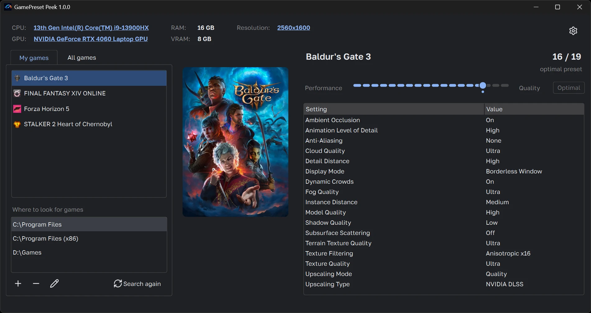

<!--suppress ALL -->
<p align="center">
    
</p>
<p align="center">
    <a href="https://www.python.org/downloads/release/python-3130/">
        
    </a>
    <a href="https://pypi.org/project/PySide6-Essentials/6.12.0/">
        
    </a>
    <a href="https://pypi.org/project/requests/2.34.2/">
        
    </a>
    <a href="https://pypi.org/project/fake-useragent/2.2.0/">
        
    </a>
    <a href="https://pypi.org/project/loguru/0.7.3/">
        
    </a>
</p>
<p align="center">
    <a href="https://github.com/iRingil/gamepreset-peek/actions/workflows/dependabot/dependabot-updates">
        
    </a>
    <a href="https://github.com/iRingil/gamepreset-peek/actions/workflows/github-code-scanning/codeql">
        
    </a>
    <a href="https://github.com/iRingil/gamepreset-peek/actions/workflows/mypy.yml">
        
    </a>
    <a href="https://github.com/iRingil/gamepreset-peek/actions/workflows/pylint.yml">
        
    </a>
    <a href="https://github.com/iRingil/gamepreset-peek/actions/workflows/pytest.yml">
        
    </a>
    <a href="https://github.com/iRingil/gamepreset-peek/actions/workflows/pytest.yml">
        
    </a>
</p>
<p align="center">
    <a href="https://github.com/iRingil/gamepreset-peek/releases/latest">
        
    </a>
    <a href="LICENSE">
        
    </a>
    <a href="https://github.com/psf/black">
        
    </a>
    <a href="https://deepwiki.com/iRingil/gamepreset-peek">
        
    </a>
</p>

**GamePreset Peek** shows the optimal game settings NVIDIA recommends for your PC, without installing NVIDIA App.

Pick a game, and the app shows its recommended graphics settings for your processor, graphics card and screen
resolution, along with every other preset NVIDIA has for that game.

<p align="center">
    
</p>

GamePreset Peek is an unofficial tool and is not affiliated with or endorsed by NVIDIA. The presets come from NVIDIA
as NVIDIA publishes them.

## Features

- **Your games and all games.** "My games" lists the games installed on this PC, found in the folders you choose;
  "All games" lists every game NVIDIA has recommendations for. Both show box art, and "All games" has a search field.
- **Your hardware.** The processor, the NVIDIA graphics card, the memory and the screen resolution are detected; the
  processor, the graphics card and the resolution can be changed to see the settings for another PC.
- **Every preset.** The recommended preset is shown first; a slider goes through the other presets NVIDIA has for the
  game, from performance to quality, and the values that differ from the recommended ones are marked.
- **Five languages.** The app and the setting names are in English, Russian, German, French and Spanish.
- **Light and dark themes**, or the one Windows uses.
- **Weekly updates** of the lists of processors, graphics cards and games, without a new version of the app.
- **Normal or portable installation**: for one Windows user, or into any folder such as a USB stick.

## Installation

Download the latest version from [Releases](https://github.com/iRingil/gamepreset-peek/releases/latest). It runs on
64-bit Windows 10 and 11 and needs an internet connection.

- `GamePresetPeek-<version>-setup.exe` is the installer. It needs no administrator rights and offers two types:
  - **Normal**: installs into `%LOCALAPPDATA%\Programs\GamePresetPeek` for the current Windows user, with a Start
    menu shortcut and an entry in Installed apps to uninstall it.
  - **Portable**: copies the app into any folder, without shortcuts, registry entries or an uninstaller.
- `GamePresetPeek-<version>-portable.zip` is the portable copy: unpack it anywhere and run `GamePresetPeek.exe`.

The app is not code-signed yet, so Windows SmartScreen may warn about it: click **More info → Run anyway**.

### Where the app keeps its files

|                                              | Normal installation                           | Portable copy                                |
|----------------------------------------------|-----------------------------------------------|----------------------------------------------|
| Settings                                     | `%LOCALAPPDATA%\GamePresetPeek\settings.json` | `userdata\settings.json` in the app's folder |
| Log                                          | `%LOCALAPPDATA%\GamePresetPeek\logs\`         | `userdata\logs\` in the app's folder         |
| Box art and icon cache                       | `%TEMP%\GamePresetPeek\`                      | `userdata\cache\` in the app's folder        |
| Database (games, processors, graphics cards) | `app\data\app.db` in the app's folder         | the same                                     |

A portable copy is a folder with `portable.txt` next to `GamePresetPeek.exe`: delete that file, and the copy keeps its
data in the user profile instead. To remove a portable copy, delete its folder. Uninstalling a normal installation
asks whether to delete the settings and the log as well; the cache is deleted anyway.

## Privacy

GamePreset Peek has no accounts, telemetry, ads or analytics. It sends only what it needs to show the presets:

- **NVIDIA** (`ops-gx.nvidia.com` and the file addresses it answers with): the names of the processor and the
  graphics card, the graphics card's device ID, the memory size and the Windows version, to check that NVIDIA supports
  the hardware and to get the presets of the game you pick.
- **NVIDIA** (`img.nvidiagrid.net`, `public.games.geforce.com`): requests for the box art of the games in the list.
- **GitHub** (`raw.githubusercontent.com`): once a week, a download of the latest database from this repository.
  Settings → Auto-update turns it off.

The games list of "My games" is built on this PC from the chosen folders and the Windows registry and is never sent
anywhere. The settings, the log and the cache stay on this PC, in the folders listed above.

## How releases are built

Every release is built from this repository by [GitHub Actions](.github/workflows/build.yml) and published by the
[Release workflow](.github/workflows/release.yml) from the files of a tested build. The app's network use is described
in [Privacy](#privacy).

## Building from source

With Python 3.13 on Windows, from the repository root:

```shell
python -m venv .venv
.venv\Scripts\activate
pip install -r src/requirements.txt -r src/requirements-dev.txt
$env:PYTHONPATH="src"; python -m app                  # run from source
pytest                                                # tests
infrastructure\nuitka\build.cmd                       # standalone folder: build\GamePresetPeek.dist
infrastructure\inno\build.cmd                         # installer and portable zip (needs Inno Setup 6)
```

## License

GamePreset Peek is released under the [MIT License](LICENSE). It is built with these third-party components:

- [Qt for Python (PySide6)](https://www.qt.io/qt-for-python) and Qt: LGPL-3.0
- [PyQtDarkTheme](https://github.com/5yutan5/PyQtDarkTheme), reworked in `src/app/ui/flat_theme`: MIT; its style sheet
  comes from [QDarkStyleSheet](https://github.com/ColinDuquesnoy/QDarkStyleSheet): MIT
- [Material design icons](https://github.com/google/material-design-icons) of the theme: Apache-2.0
- [requests](https://github.com/psf/requests), [urllib3](https://github.com/urllib3/urllib3),
  [idna](https://github.com/kjd/idna), [charset-normalizer](https://github.com/jawah/charset_normalizer),
  [certifi](https://github.com/certifi/python-certifi): Apache-2.0, MIT, BSD-3-Clause, MIT, MPL-2.0
- [fake-useragent](https://github.com/fake-useragent/fake-useragent): Apache-2.0
- [loguru](https://github.com/Delgan/loguru): MIT
- [Lucide](https://lucide.dev) icons: ISC
- [flag-icons](https://github.com/lipis/flag-icons): MIT
- [Golos Text](https://github.com/googlefonts/golos-text) font: SIL Open Font License 1.1
- [Python](https://www.python.org) runtime, compiled with [Nuitka](https://nuitka.net): PSF License, Apache-2.0
